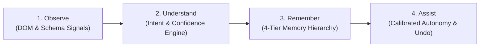

# Browsify — Universal Proactive Browser Agent

> **Track 2: Beyond the Browser — Reimagine How We Use the Web**  
> **Team:** The Qubits  
> **Platform:** Google Chrome Extension (Manifest V3)  
> **Tagline:** *"Browse naturally. Let your AI companion take care of the rest."*

---

## 🌟 Executive Overview

The web contains boundless information, but the human browser is forced to act like a manual data router: endlessly switching between tabs, copying and pasting product specifications, cross-checking retail prices, and carrying research context by hand.

Most current AI assistants are **strictly reactive**—they sit silently waiting for user prompts, creating "blank prompt fatigue."

**Browsify** inverts this paradigm. It is a **Universal Proactive Browser Agent** that lives inside the Chrome Side Panel. Designed with a warm, calm, paper-like aesthetic reminiscent of Claude and ChatGPT light mode, Browsify:
- **Observes** your browsing activity with explicit opt-in permission.
- **Understands** your current intent across Shopping, Learning, Research, and Productivity.
- **Remembers** structured context across sessions in a 4-tier memory hierarchy.
- **Assists** proactively with controlled autonomy based on calibrated confidence scores.

---

## 🔄 Core Product Loop: Observe → Understand → Remember → Assist



### 1. Observe (Passive & Non-Intrusive)
- Monitors tab navigations, titles, OpenGraph tags, and Schema.org JSON-LD data (`Product`, `Course`, `ScholarlyArticle`).
- **Zero Sensitive Data Ingestion**: Passwords, banking inputs, payment fields, and CVVs are completely bypassed by design.

### 2. Understand (Intent Classification)
- Classifies user behavior into specialized domains:
  - 🛒 **Shopping & Commerce**: Hardware listings, price comparisons, spec extraction.
  - 🎓 **Education & Learning**: Tutorials, course curricula, skill tracking.
  - 🔬 **Research & Deep Work**: Academic papers, developer docs, ecosystem hubs (e.g. Framer MCP).
  - ⚡ **Productivity & Repetitive Workflows**: Form autofill routines, bookmark synthesis.

### 3. Remember (4-Tier Structured Memory Hierarchy)
- **Layer 1: Live Context**: Immediate DOM signals, active tab title, and product/article schema.
- **Layer 2: Session Memory**: Rolling sequence of visited domains, search transitions, and time spent.
- **Layer 3: Long-Term Memory**: Persisted user preferences, saved vaults, and exclusion rules.
- **Layer 4: Task State Machine**: Ongoing workflow state trackers (e.g., cross-store comparison, course progress).

### 4. Assist (Controlled Autonomy & Safety First)
- **< 60% Confidence**: Silent observation mode. No UI interruptions.
- **60% – 85% Confidence**: Non-intrusive action cards requiring single-click approval.
- **> 85% Confidence**: Performs safe, reversible actions automatically with an **8-second Undo toast**.
- **Financial & Identity Security Gate**: Purchases, payments, and account changes **strictly require explicit user confirmation** via a secure `ApprovalModal`.

---

## 🎯 Specialized Handlers & Demo Scenarios

Browsify comes pre-configured with four complete demo handlers accessible via the instant **`DEMO:` quick-switcher bar**:

### 1. 🛒 Proactive Shopping Assistant (TechBazaar Apple MacBook Air 15" M3)
- **Autonomous Detection**: Recognizes an e-commerce laptop listing ($1,299.00 on TechBazaar).
- **Hardware Comparison Matrix**: Automatically constructs a comparative table against alternative machines:
  - **MacBook Air 15" M3** ($1,299 | 18h Battery ★ Best | Apple M3 | 3.3 lbs)
  - **Dell XPS 15** ($1,449 | 12h Battery | i7-13700H | 4.2 lbs)
  - **ThinkPad X1** ($1,380 | 14h Battery | i7-1365U | 2.48 lbs ★ Lightest)
- **Savings Analysis**: Highlights $150 in savings compared to competitor retail stores.
- **Price Tracking & Vault**: Single-click price tracking alert and product saving.

### 2. 🎓 Personalized Learning Companion (EduCode Academy Data Structures)
- **Curriculum Recognition**: Detects linked lists and data structure tutorials.
- **Progress Tracking Ring**: Visualizes completion percentage (2 of 6 modules completed).
- **Interactive Roadmap**: Tracks Arrays, Linked Lists, Stacks, Queues, Binary Trees, and Graphs.
- **Active Revision Quizzes**: Interactive flashcard question testing time complexity (e.g., $O(1)$ amortized append).

### 3. 🔬 Research & Developer Ecosystem (AI Agents & Framer MCP)
- **Scholarly Article Mode**: Synthesizes the peer-reviewed paper *"Autonomous Proactive Agents in Web Browsing"*, producing executive TL;DRs and key takeaways.
- **Framer Model Context Protocol (MCP) Mode**: Explores Framer's AI connector hub, categorizing supported coding agents (Claude, Claude Code, Cursor, ChatGPT, Codex, and Grok Bot).

### 4. ⚡ Productivity & Smart Autofill
- **Routine Detection**: Detects frequent morning workflows (e.g., opening GitHub, LeetCode, and Gmail).
- **Non-Sensitive Autofill**: Offers safe autofill for non-sensitive public form fields with full disclaimers.

---

## 🎨 Design System & Tokens

Browsify uses a custom design system inspired by Claude and ChatGPT light mode:

| Token | Value | Purpose |
| :--- | :--- | :--- |
| `--bg` | `#FAF7F0` | Main paper-like cream background |
| `--bg-subtle` | `#F4F0E6` | Secondary surfaces, hover states, input backgrounds |
| `--surface` | `#FFFDF8` | Card backgrounds |
| `--surface-raised` | `#FFFFFF` | Modal dialogs and elevated popovers |
| `--border` | `#E8E2D3` | Soft borders replacing harsh shadows |
| `--text` | `#2B2A27` | Primary soft near-black text |
| `--text-secondary`| `#6B675E` | Subtitles, meta tags, and helper copy |
| `--accent` | `#C4623F` | Warm terracotta brand accent & primary CTAs |
| `--accent-soft` | `#F6E4DB` | Tinted status badges & active tabs |
| `--success` | `#5F8A5B` | Best price badges, high confidence indicators |
| `--info` | `#5C7C99` | Extended warranty pills, research chips |

Typography utilizes characterful serifs (`Fraunces`, `Newsreader`, `Georgia`) for headings and clean, bundled `Inter` for UI readability.

---

## 🚀 Setup & Execution Guide

### Option A: Load into Google Chrome (Manifest V3 Side Panel)

1. Build the production extension package:
   ```bash
   npm run build
   ```
2. Open Google Chrome and navigate to:
   ```text
   chrome://extensions/
   ```
3. Enable **Developer mode** in the top-right corner.
4. Click **Load unpacked** (top-left).
5. Select the `dist/extension/` directory:
   ```text
   c:\Users\Dell\Desktop\BrowserPilot\dist\extension
   ```
6. *(Optional)* Click **Details** on the Browsify card and enable **"Allow access to file URLs"**.
7. Pin Browsify to your toolbar, click its icon, and choose **"Open Side Panel"**.
8. Open the bundled demo pages in your browser:
   ```text
   demo-pages/shopping-laptop.html
   demo-pages/education-linked-lists.html
   demo-pages/research-ai-agents.html
   ```

### Option B: Standalone Web Preview Mode

You can also preview and interact with the UI in a standard web browser without installing the extension:

```bash
npm run dev
```

- Open `http://localhost:5173/` in your browser.
- The interface renders inside a 400px centered frame mimicking the Chrome Side Panel.
- Use the **Demo Controls** drawer (bottom-right) to toggle confidence levels and switch scenarios.
- Visit `http://localhost:5173/#styleguide` to view the comprehensive UI component library.

---

## 📁 Repository Structure

```text
BrowserPilot/
├── package.json                      # Scripts & dependencies (React 18, Vite 6, Lucide)
├── vite.config.js                    # Multi-page build config (index, sidepanel, popup)
├── scripts/
│   └── copy-extension-assets.js      # Packages loadable extension into dist/extension/
│
├── demo-pages/                       # Test pages for live evaluation
│   ├── index.html                    # Demo launcher hub
│   ├── shopping-laptop.html          # TechBazaar MacBook Air 15" M3 listing
│   ├── education-linked-lists.html   # EduCode Academy Linked Lists course
│   └── research-ai-agents.html       # Peer-reviewed Autonomous Agents paper
│
├── extension/                        # Manifest V3 Extension Source
│   ├── manifest.json                 # Permissions (sidePanel, storage, activeTab)
│   ├── background.js                 # Service worker coordinating tab changes
│   ├── content.js                    # Non-invasive DOM & schema extractor
│   ├── icons/                        # Extension icons (16px, 48px, 128px)
│   │
│   ├── popup/                        # 320px toolbar popup
│   │   ├── index.html
│   │   ├── popup.jsx
│   │   └── popup.css
│   │
│   ├── utils/
│   │   ├── storage.js                # chrome.storage.local with localStorage fallback
│   │   └── messaging.js              # chrome.runtime.sendMessage with dev fallback
│   │
│   └── sidepanel/                    # React Side Panel Application
│       ├── index.html
│       ├── main.jsx
│       ├── App.jsx                   # Central state machine & view router
│       │
│       ├── styles/
│       │   ├── tokens.css            # Centralized CSS variables (design tokens)
│       │   └── global.css            # Base typography, animations, scrollbars
│       │
│       ├── data/
│       │   └── mock.js               # Mock data store for all 4 tracks
│       │
│       ├── components/               # Shared component library
│       │   ├── Header.jsx            # Sticky header with 1-click DEMO switcher bar
│       │   ├── PageStrip.jsx         # Live page context & intent correction
│       │   ├── Tabs.jsx              # Segmented pill tabs with notification badges
│       │   ├── Card.jsx & Chip.jsx   # Styled paper cards & semantic chips
│       │   ├── StatusPill.jsx        # Agent status (Observing, Paused, Suggesting, Acting)
│       │   ├── Toast.jsx             # 8-second countdown Toast with Undo action
│       │   ├── ApprovalModal.jsx     # Security authorization dialog for sensitive tasks
│       │   ├── DemoControls.jsx      # Dev simulation drawer for confidence & tracks
│       │   └── Styleguide.jsx        # Live UI component library
│       │
│       └── views/                    # Application Views
│           ├── OnboardingView.jsx    # Privacy disclosures & opt-in flow
│           ├── ActivityView.jsx      # Live hero card, timeline & intent status
│           ├── SuggestionsView.jsx   # Proactive suggestion cards
│           ├── ShoppingPanel.jsx     # MacBook Air M3 hardware comparison & pricing
│           ├── LearningPanel.jsx     # Linked Lists curriculum roadmap & quiz
│           ├── ResearchPanel.jsx     # AI Agents synthesis & Framer MCP hub
│           ├── ProductivityPanel.jsx # Routine automation & smart autofill
│           ├── MemoryView.jsx        # 4-tier memory hierarchy browser
│           └── SettingsView.jsx      # Autonomy slider, pause timer & domain blacklist
```

---

## 🔒 Privacy & Ethical AI Principles

1. **Opt-In by Default**: Observation only runs with explicit user consent.
2. **Instant Pause & Domain Blacklisting**: Users can pause observation at any time or add sensitive domains (banks, health portals, email) to an exclusion list.
3. **No Sensitive Data Ingestion**: Form inputs marked with `password`, `credit-card`, or sensitive autocomplete tags are ignored by the content script.
4. **Transparent Memory**: Every memory tier is inspectable and erasable via the Memory tab.
5. **Human In The Loop**: High-stakes operations (orders, payments, personal data transmission) are never automated.

---

## 👥 Team: The Qubits

Developed for **Track 2: Beyond the Browser — Reimagine How We Use the Web**.  
*Browse naturally. Let your AI companion take care of the rest.*
